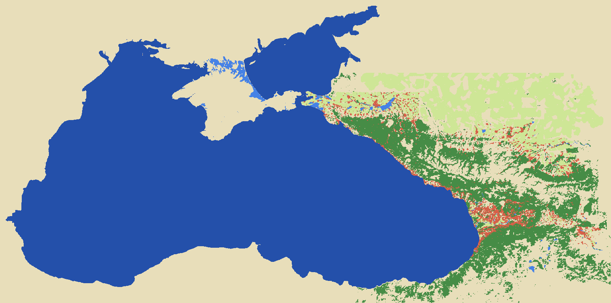
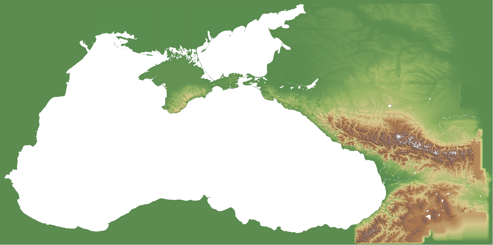

# terrain-geodata

Reads terrain data from a DCS World install and exports it to
[`docs/data/terrains/<theatre>/`](../../docs/data/terrains/): land cover
classes such as forest, town and water, ground elevation, named places, map
features such as roads, railways, rivers and borders, and the terrain's
projection, which converts lat/long to DCS coordinates.

## Usage

You must use [uv](https://docs.astral.sh/uv/) to run this tool. Trying to run it
with just `python terrain_geodata/cli.py` will not work.

```bash
# List the terrains found in the DCS install
uv run terrain-geodata list
# Export every terrain to docs/data/terrains
uv run terrain-geodata export --out ../../docs/data/terrains
# Export only the Caucasus terrain
uv run terrain-geodata export --out ../../docs/data/terrains --terrain Caucasus
# Export the Caucasus terrain with 25 m land cover and 50 m elevation pixels
uv run terrain-geodata export --out /tmp/terrains --terrain Caucasus \
  --landcover-resolution 25 --elevation-resolution 50
```

On Windows the install folder is read from the registry (standalone or Steam).
Elsewhere, or to use a different install, pass `--dcs-path` or set the
`DCS_PATH` environment variable. `--out` defaults to `docs/data/terrains`
relative to the current directory. `--landcover-resolution` sets the land cover pixel
size (default 100 m) and `--elevation-resolution` the elevation pixel size
(default 1 km). `--jobs` sets the number of worker processes (default one per
CPU).

An export at the default resolutions uses about 3 GB of RAM and 1 GB of
temporary disk space. With 25 m land cover it uses up to about 8 GB of RAM and
16 GB of temporary disk space.

## Output

Each terrain's files are in
[`docs/data/terrains/<theatre>/`](../../docs/data/terrains/), where
`<theatre>` is the theatre id that missions store in `mission.theatre`, such as `Caucasus`.

| File            | Format                  | Contents                                                          |
| --------------- | ----------------------- | ----------------------------------------------------------------- |
| `terrain.json`  | JSON                    | Projection parameters, raster extent, feature counts, class areas |
| `places.csv`    | CSV                     | Named places with lat/long and DCS `x`/`z`                        |
| `features.gpkg` | GeoPackage (SQLite)     | Vector layers from the Mission Editor map                         |
| `landcover.tif` | Cloud-optimized GeoTIFF | Land cover classes from the terrain mesh                          |
| `elevation.tif` | Cloud-optimized GeoTIFF | Ground height in metres from the terrain mesh                     |

All geometry is in the terrain's own transverse Mercator projection. Each
position in the files is an easting and northing in metres, and these equal DCS
coordinates: **easting is DCS `z` and northing is DCS `x`**. A point at
`(E, N)` in a file is DCS `x = N`, `z = E` (Vec2 `{x = N, y = E}`).
These files can be read in tools like QGIS, GDAL, `rasterio` and `geopandas`.

### Coordinate System

Each terrain is a transverse Mercator projection on the WGS84 ellipsoid with
scale factor 0.9996 and latitude of origin 0. `x` increases to the north and `z`
to the east, in metres.

| Theatre              | Central meridian | False easting (m) | False northing (m) | Fit error |
| -------------------- | ---------------- | ----------------- | ------------------ | --------- |
| `Afghanistan`        | 63°              | -300,150          | -3,759,657         | 7 cm      |
| `Caucasus`           | 33°              | -99,517           | -4,998,115         | 7 cm      |
| `GermanyCW`          | 21°              | 35,427.617        | -6,061,633.131     | 7 cm      |
| `Kola`               | 21°              | -62,702           | -7,543,625         | 6 cm      |
| `MarianaIslandsWWII` | 147°             | 238,418           | -1,491,840         | 6 cm      |
| `MarianaIslands`     | 147°             | 238,418           | -1,491,840         | 8 cm      |
| `Nevada`             | -117°            | -193,996.810      | -4,410,028.066     | 7 cm      |
| `Normandy`           | -3°              | -195,526          | -5,484,813         | 7 cm      |
| `PersianGulf`        | 57°              | 75,756            | -2,894,933         | 7 cm      |
| `SinaiMap`           | 33°              | 169,222           | -3,325,313         | 7 cm      |
| `Syria`              | 39°              | 282,801           | -3,879,866         | 7 cm      |

`fit error` is the largest difference between positions computed with the
projection and the reference positions in the game files (beacon and town
positions given in both lat/long and DCS coordinates). A few centimetres means the parameters are exact. `terrain.json`
contains the same values and a `proj4` string.

To convert with `pyproj`:

```python
import json
from pyproj import Transformer

crs = json.load(open("docs/data/terrains/Caucasus/terrain.json"))["crs"]["proj4"]
to_dcs = Transformer.from_crs("EPSG:4326", crs, always_xy=True)
z, x = to_dcs.transform(41.6, 41.6)  # (longitude, latitude) in, (z, x) out
```

### Land Cover

`landcover.tif` is a single-band `uint8` raster with the pixel size set by
`--landcover-resolution` (default 100 m). Each pixel value is the class of
the terrain mesh triangle under the pixel centre. Where classes overlap, the
class with the higher value is used (a river through a forest is `river`).



| Value | Class    | Color       | Meaning                                                         |
| ----- | -------- | ----------- | --------------------------------------------------------------- |
| 0     | `nodata` | Transparent | Outside the terrain mesh                                        |
| 1     | `land`   | Beige       | Open ground: grass, scrub, rock, desert, snow                   |
| 2     | `field`  | Light green | Farmland                                                        |
| 3     | `forest` | Green       | Forest                                                          |
| 4     | `town`   | Red         | Built-up ground texture: cities, villages and scattered housing |
| 5     | `beach`  | Pale yellow | Beach and the shoreline strip                                   |
| 6     | `river`  | Light blue  | River surface                                                   |
| 7     | `lake`   | Blue        | Lake or reservoir                                               |
| 8     | `sea`    | Dark blue   | Sea                                                             |
| 9     | `runway` | Dark grey   | Runway and airfield paving                                      |

Things to keep in mind:

- `town` is derived from the ground texture under buildings, so it
  overestimates built-up area: in densely settled regions it covers whole
  valleys of villages. A `town` pixel means buildings are likely, not that a
  spot is blocked.
- Roads and railways are not in the raster.
- `land` includes steep mountainsides. Check slope at runtime by sampling
  `land.getHeight` around a spot before placing ground units there.
- Large areas at the map edges are low-detail mesh. They have land cover
  classes (mostly `land` and `sea`) but no towns, roads or forest.

Sample a class at a DCS position:

```python
import rasterio

with rasterio.open("docs/data/terrains/Caucasus/landcover.tif") as src:
    x, z = -276848.2, 646568.0  # Senaki, from places.csv
    [value] = next(src.sample([(z, x)]))
    print(src.tags(1)[f"CLASS_{value}"])
```

### Elevation

`elevation.tif` is a single-band `int16` raster of height above sea level in
whole metres, with the pixel size set by `--elevation-resolution` (default
1 km). Each pixel is the terrain mesh height at its
centre, interpolated across the triangle under it. Sea, lakes and
pixels outside the mesh are `-32768` (the raster's nodata value). `terrain.json`
records the pixel size and the lowest and highest values under `elevation`.



Use it for planning at map scale: which areas are mountains, valleys or
plains, where low ground lies between ridges, and the approximate height of a
region. For anything that depends on the exact spot, such as slope under a unit
or line of sight, query the terrain at runtime with `land.getHeight`, `land.getIP` and
`land.isVisible`.

The committed files use the 1 km default to keep the repository small. For finer
heights, re-export a terrain with a smaller pixel; the mesh has vertices
about 50 m apart in detailed areas, so a smaller pixel adds no detail:

```bash
uv run terrain-geodata export --out /tmp/terrains --terrain Caucasus --elevation-resolution 50
```

Things to keep in mind:

- Sea and lakes are nodata to keep the files small. The mesh height there is
  the sea or lake bed, which is up to thousands of metres below sea level and
  made up a large share of the file size on maps with deep sea.
- Rivers are not nodata. A river is tens of metres wide, so a pixel centre is
  rarely on a river surface. When it is, the pixel value is the height of the
  river bed. Setting river pixels to nodata would leave scattered nodata pixels
  along valleys. Use `landcover.tif` or the `rivers` layer to find rivers.
- A pixel is the height at one point, not the average or peak of the square
  around it. Ridgelines, cliffs and narrow valleys between pixel
  centres are not in the data.
- `elevation.tif` also contains overviews: copies at 2, 4 and more times the
  pixel size, which GIS tools read when zoomed out. Each overview
  pixel is the mean of the pixels it covers, so zoomed-out views show average
  heights and peaks lower than their true height. Reads at full resolution,
  such as `sample` or `read(1)`, use the full-resolution pixels.

Sample a height, and find the places above 1,500 m:

```python
import csv
import rasterio

with rasterio.open("docs/data/terrains/Caucasus/elevation.tif") as src:
    x, z = -276848.2, 646568.0  # Senaki, from places.csv
    [height] = next(src.sample([(z, x)]))
    print(height)

    rows = list(csv.DictReader(open("docs/data/terrains/Caucasus/places.csv")))
    points = [(float(r["z"]), float(r["x"])) for r in rows]
    high = [
        r["name"]
        for r, [h] in zip(rows, src.sample(points))
        if h != src.nodata and h > 1500
    ]
```

### Feature Layers

`features.gpkg` has one layer per feature type. Line segments that share
an endpoint are merged into one line. Overlapping and adjacent polygons are
merged into one polygon.

| Layer         | Geometry   | Attribute                       | Contents                            |
| ------------- | ---------- | ------------------------------- | ----------------------------------- |
| `places`      | Point      | `name`, `latitude`, `longitude` | Named places at map label positions |
| `roads`       | LineString | `length_m`                      | Roads                               |
| `railways`    | LineString | `length_m`                      | Railways                            |
| `rivers`      | LineString | `length_m`                      | River centrelines                   |
| `power_lines` | LineString | `length_m`                      | Power lines                         |
| `borders`     | LineString | `length_m`                      | National and administrative borders |
| `urban_areas` | Polygon    | `area_m2`                       | Town outlines on the map            |
| `runways`     | Polygon    | `area_m2`                       | Runway outlines                     |

These layers are the lines and polygons the Mission Editor draws over its map.
Not every terrain's map has every feature type. For example, the Mariana
Islands map has no roads, rivers or borders. A layer can therefore be empty on
some terrains. For water, forest and built-up areas, use `landcover.tif`, which
has data for every terrain.

The `roads` layer may not include every road in the 3D terrain.

SQLite can query the attribute columns:

```bash
sqlite3 docs/data/terrains/Caucasus/features.gpkg \
  "SELECT count(*), round(sum(length_m) / 1000) AS km FROM railways"
```

Use a GIS library such as `geopandas` to read geometry:

```python
import geopandas as gpd
from shapely import Point

roads = gpd.read_file("docs/data/terrains/Caucasus/features.gpkg", layer="roads")
x, z = -276848.2, 646568.0  # Senaki, from places.csv
print(roads.distance(Point(z, x)).min())  # metres to the nearest road in the layer
```

### Places

`places.csv` lists every named place on the Mission Editor map: `name`,
`latitude`, `longitude`, `x`, `z`. `latitude` and
`longitude` are read from the terrain's `Map/towns.lua`. `x` and `z` are the
position of the place's label on the Mission Editor map. The list includes
cities, villages and some landmarks, and does not rank places by size.

## Adding or updating terrains

Re-run the export after installing a new terrain and after any DCS update that
patches a terrain, then review the diff of each `terrain.json`. `terrain.json`
records the DCS version used for the export.

After exporting a new terrain, check the export log for
`skipped map materials`: these are overlay line or polygon sets the tool could
not assign to a layer. Lines with a road-like material name (`Road`, `Rail`,
`Railway`) are assigned to `roads` or `railways` based on the type of the mesh
triangles under them. To assign a set that matches neither, plot it to identify
it, then add it to `OVERLAY_OVERRIDES` in [export.py](terrain_geodata/export.py).
Some maps draw lines as thin polygon strips instead of line sets (Afghanistan
draws its borders this way). Override such a set to a line layer to export its
centrelines. For example, this exports Afghanistan's `Undef/TRI/colorIndex=13`
and `Undef/TRI/colorIndex=2` polygon sets as border lines:

```python
OVERLAY_OVERRIDES = {
    "Afghanistan": {("Undef", "13"): "borders", ("Undef", "2"): "borders"},
}
```
